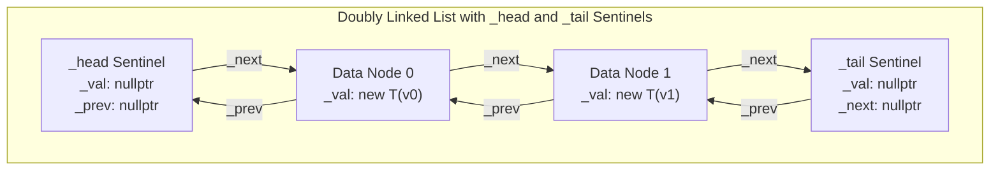

# List — Custom STL-Compatible Doubly Linked List in C++20


A header-only generic C++20 implementation of a doubly linked list (`List<T>`), developed as part of a university **Data Structures** course. Designed to closely replicate `std::list<T>` from the C++ Standard Template Library (STL), `List<T>` features a dual-sentinel (`_head` / `_tail`) architecture, four C++20-compliant bidirectional iterator types, support for non-default-constructible types, and built-in list algorithms (`merge`, `sort`, `insert`, `erase`).

---

## Table of Contents

- [Overview](#overview)
- [Key Technical Features](#key-technical-features)
- [Dual-Sentinel Architecture](#dual-sentinel-architecture)
- [Project Structure](#project-structure)
- [API Reference & Complexity](#api-reference--complexity)
- [Code Examples](#code-examples)
- [Test Suite (TDD)](#test-suite-tdd)
- [Building & Running](#building--running)
- [Author](#author)

---

## Overview

A doubly linked list provides $O(1)$ insertion and erasure anywhere in the sequence given an iterator, as well as bidirectional traversal from both ends. Implementing an STL-grade `List<T>` requires:
1. Avoiding edge-case pointer bugs when inserting or erasing at the boundaries (empty list, first node, last node).
2. Supporting element types `T` that **do not have a default constructor** even when sentinel/dummy nodes are used.
3. Providing full iterator interoperability (`iterator`, `const_iterator`, `reverse_iterator`, `const_reverse_iterator`) that satisfies C++20 `std::bidirectional_iterator` concepts and works seamlessly with `<algorithm>` functions and range-based `for` loops.

This implementation in [`List/List.h`](List/List.h) satisfies all of these requirements and passes **22 automated TDD test suites** in [`List/Tests/`](List/Tests/).

---

## Key Technical Features

- **Dual Sentinel Nodes with Indirect Value Storage (`T* _val`)**
  - Every `List<T>` maintains two permanent dummy sentinel nodes: `_head` (before the first element) and `_tail` (past the last element), initialized with `_head->_next = _tail` and `_tail->_prev = _head`.
  - Each `Node` stores a pointer `T* _val` (`nullptr` for sentinel nodes; `new T(val)` for active data nodes).
  - **Why this matters**: Sentinel nodes never invoke `T()`! Consequently, `List<T>` can be instantiated for classes with **no default constructor** (`Test 17`), and every `push_front`, `push_back`, `insert`, and `erase` operates uniformly on interior pointers without `nullptr` branches.
- **C++20 Concepts Verification**
  - Validates iterator conformance at compile time via:
    ```cpp
    static_assert(std::bidirectional_iterator<iterator>);
    ```
  - Provides a range constructor constrained by C++20 `std::input_iterator`:
    ```cpp
    template <std::input_iterator iter>
    List(iter begin, iter end);
    ```
- **Four Complete Bidirectional Iterator Classes**
  - `iterator` (`begin()`, `end()`)
  - `const_iterator` (`begin() const`, `end() const`, `cbegin()`, `cend()`)
  - `reverse_iterator` (`rbegin()`, `rend()`)
  - `const_reverse_iterator` (`rbegin() const`, `rend() const`, `crbegin()`, `crend()`)
- **Built-In `merge()` & `sort()` Algorithms**
  - `merge(List& other)` merges two sorted lists in $O(N + M)$ linear time and empties `other`.
  - `sort()` sorts the list in ascending order using an early-terminating swap pass.

---

## Dual-Sentinel Architecture



- `begin()` points to `_head->_next` (`Data Node 0`, or `_tail` when empty).
- `end()` points to `_tail`.
- `rbegin()` points to `_tail->_prev` (`Data Node 1`, or `_head` when empty).
- `rend()` points to `_head`.

---

## Project Structure

```text
List/
├── List.sln                                                # Visual Studio 2022 Solution
├── .gitignore                                              # Visual Studio & build artifact ignores
├── README.md                                               # Project documentation
│
└── List/
    ├── List.h                                              # Generic List<T> & 4 bidirectional iterator classes
    ├── main.cpp                                            # Test runner entry point
    ├── List.vcxproj                                        # MSVC C++20 project configuration (v143)
    ├── List.vcxproj.filters                                # Solution Explorer filters
    │
    └── Tests/                                              # 22 Modular TDD Test Suites
        ├── 1BasicConstructorsTest.h                        # Default, sized, and value-fill constructors
        ├── 2PushFrontBackTest.h                            # push_front() and push_back() operations
        ├── 3PopFrontBackTest.h                             # pop_front() and pop_back() operations
        ├── 4DestructorCallTest.h                           # Exact ~T() destructor call verification
        ├── 5CopyConstructorTest.h                          # Deep copy constructor & equality operators
        ├── 6AssignmentOperatorTest.h                       # Copy assignment & self-assignment safety
        ├── 7DestructorWithAssignmentTest.h                 # Resource cleanup on copy assignment overwrite
        ├── 8ConstFrontBackTest.h                           # Mutable and const front() / back()
        ├── 9ClearTest.h                                    # clear() and empty() state verification
        ├── 10BasicIteratorTest.h                           # Bidirectional ++ and -- on iterator
        ├── 11ReverseIteratorTest.h                         # rbegin() and rend() reverse traversal
        ├── 12ConstIteratorTest.h                           # cbegin() and cend() read-only traversal
        ├── 13ConstReverseIteratorTest.h                    # crbegin() and crend() reverse read-only traversal
        ├── 14MemberAccessIteratorTest.h                    # operator->() across all 4 iterator types
        ├── 15InitializerListConstructorTest.h              # std::initializer_list<T> construction
        ├── 16IteratorConstructibleTest.h                   # C++20 std::input_iterator range constructor
        ├── 17ClassWithNoDefaultConstructorTest.h           # Instantiation with non-default-constructible types
        ├── 18InsertTest.h                                  # Positional insert(iterator, val)
        ├── 19EraseTest.h                                   # Positional erase(iterator) & destructor check
        ├── 20MergeTest.h                                   # Ordered merge(List&) of two sorted lists
        ├── 21SortTest.h                                    # In-place sort() verification
        ├── 22StlCompatibilityTest.h                        # std::count, std::count_if, std::all_of, range-for
        └── Fixtures/
            └── CustomAsserts.h                             # Assertion helpers & diagnostic output
```

---

## API Reference & Complexity

### Constructors, Destructor & Assignment

| Member | Signature | Time Complexity | Description |
| :--- | :--- | :---: | :--- |
| **Default Ctor** | `List()` | $O(1)$ | Allocates `_head` and `_tail` sentinels and links them (`_size = 0`). |
| **Sized Ctor** | `List(size_t size)` | $O(N)$ | Constructs `size` default-initialized `T()` nodes. |
| **Fill Ctor** | `List(size_t size, const T& val)` | $O(N)$ | Constructs `size` nodes initialized with `val`. |
| **Copy Ctor** | `List(const List& other)` | $O(N)$ | Deep-copies all elements from `other`. |
| **Initializer List Ctor** | `List(std::initializer_list<T> initList)` | $O(N)$ | Constructs list from `initList`. |
| **Range Ctor** | `template <std::input_iterator iter>`<br>`List(iter begin, iter end)` | $O(N)$ | Constructs list from any input iterator range `[begin, end)`. |
| **Destructor** | `~List()` | $O(N)$ | Deletes all data nodes (invoking `delete _val`) and both sentinels. |
| **Copy Assignment** | `List& operator=(const List& other)` | $O(N + M)$ | Clears current elements and deep-copies `other` (self-assignment safe). |

### Element Access, Capacity & Modifiers

| Method | Signature | Time Complexity | Description |
| :--- | :--- | :---: | :--- |
| `front` | `T& front()` / `const T& front() const` | $O(1)$ | Returns reference to the first element (`*(_head->_next->_val)`). |
| `back` | `T& back()` / `const T& back() const` | $O(1)$ | Returns reference to the last element (`*(_tail->_prev->_val)`). |
| `empty` | `bool empty()` | $O(1)$ | Returns `true` if `_size == 0`. |
| `size` | `size_t size()` | $O(1)$ | Returns the cached element count `_size`. |
| `push_front` | `void push_front(const T& val)` | $O(1)$ | Inserts `val` immediately after `_head`. |
| `push_back` | `void push_back(const T& val)` | $O(1)$ | Inserts `val` immediately before `_tail`. |
| `pop_front` | `void pop_front()` | $O(1)$ | Removes the first element (no-op if empty). |
| `pop_back` | `void pop_back()` | $O(1)$ | Removes the last element (no-op if empty). |
| `insert` | `void insert(const iterator& iter, const T& val)` | $O(1)$ | Inserts `val` immediately before `iter`. |
| `erase` | `void erase(const iterator& iter)` | $O(1)$ | Unlinks and deletes the node at `iter`. |
| `clear` | `void clear()` | $O(N)$ | Deletes all data nodes while keeping `_head` and `_tail` sentinels intact. |
| `merge` | `void merge(List& other)` | $O(N + M)$ | Merges sorted list `other` into `*this` in sorted order and clears `other`. |
| `sort` | `void sort()` | $O(N^2)$ | Sorts elements in ascending order (`Best Case: O(N)` when already sorted). |
| `operator==` / `!=` | `bool operator==(const List<U>&, const List<U>&)` | $O(N)$ | Element-wise equality comparison. |

---

## Code Examples

```cpp
#include "List/List.h"
#include <algorithm>
#include <iostream>
#include <vector>

int main()
{
    // Construct from std::vector using C++20 std::input_iterator range constructor
    std::vector<int> src = { 6, 2, 9, 1, 5 };
    List<int> lst(src.begin(), src.end());

    lst.push_front(10);
    lst.push_back(0);
    lst.sort(); // 0, 1, 2, 5, 6, 9, 10

    // Merge with another sorted List
    List<int> other = { 3, 4, 8 };
    lst.merge(other);

    // Traverse in reverse using const_reverse_iterator
    for (auto it = lst.crbegin(); it != lst.crend(); ++it)
        std::cout << *it << " "; // Output: 10 9 8 6 5 4 3 2 1 0
    std::cout << "\n";

    // Full compatibility with STL <algorithm>
    auto evens = std::count_if(lst.begin(), lst.end(), [](int x) { return x % 2 == 0; });
    std::cout << "Even count: " << evens << "\n";
    return 0;
}
```

---

## Test Suite (TDD)

All **22 unit test suites** in [`List/Tests/`](List/Tests/) execute automatically during static initialization before `main()`:

| # | Test File | Verified Behavior |
| :-: | :--- | :--- |
| **1** | [`1BasicConstructorsTest.h`](List/Tests/1BasicConstructorsTest.h) | Default, sized, and value-fill constructors. |
| **2** | [`2PushFrontBackTest.h`](List/Tests/2PushFrontBackTest.h) | Interleaved `push_front()` and `push_back()` insertions. |
| **3** | [`3PopFrontBackTest.h`](List/Tests/3PopFrontBackTest.h) | `pop_front()` and `pop_back()` boundary removal. |
| **4** | [`4DestructorCallTest.h`](List/Tests/4DestructorCallTest.h) | Exact `~T()` destructor call count on scope exit. |
| **5** | [`5CopyConstructorTest.h`](List/Tests/5CopyConstructorTest.h) | Deep copy construction and `operator==` / `operator!=`. |
| **6** | [`6AssignmentOperatorTest.h`](List/Tests/6AssignmentOperatorTest.h) | Copy assignment and self-assignment (`lst = lst`). |
| **7** | [`7DestructorWithAssignmentTest.h`](List/Tests/7DestructorWithAssignmentTest.h) | Verifies existing elements are destroyed on copy assignment. |
| **8** | [`8ConstFrontBackTest.h`](List/Tests/8ConstFrontBackTest.h) | Mutable and `const` `front()` / `back()` overloads. |
| **9** | [`9ClearTest.h`](List/Tests/9ClearTest.h) | `clear()` and subsequent container reuse. |
| **10** | [`10BasicIteratorTest.h`](List/Tests/10BasicIteratorTest.h) | Forward (`++`) and backward (`--`) traversal with `iterator`. |
| **11** | [`11ReverseIteratorTest.h`](List/Tests/11ReverseIteratorTest.h) | Reverse traversal and mutation via `rbegin()` / `rend()`. |
| **12** | [`12ConstIteratorTest.h`](List/Tests/12ConstIteratorTest.h) | Read-only bidirectional traversal via `cbegin()` / `cend()`. |
| **13** | [`13ConstReverseIteratorTest.h`](List/Tests/13ConstReverseIteratorTest.h) | Read-only reverse traversal via `crbegin()` / `crend()`. |
| **14** | [`14MemberAccessIteratorTest.h`](List/Tests/14MemberAccessIteratorTest.h) | `operator->()` across `iterator`, `const_iterator`, `reverse_iterator`, and `const_reverse_iterator`. |
| **15** | [`15InitializerListConstructorTest.h`](List/Tests/15InitializerListConstructorTest.h) | Construction from `std::initializer_list<T>`. |
| **16** | [`16IteratorConstructibleTest.h`](List/Tests/16IteratorConstructibleTest.h) | Range construction from `std::vector` and `std::initializer_list` iterators. |
| **17** | [`17ClassWithNoDefaultConstructorTest.h`](List/Tests/17ClassWithNoDefaultConstructorTest.h) | Storing and iterating over types without a default constructor. |
| **18** | [`18InsertTest.h`](List/Tests/18InsertTest.h) | Positional `insert(iterator, val)` at head, middle, and tail. |
| **19** | [`19EraseTest.h`](List/Tests/19EraseTest.h) | Positional `erase(iterator)` at head, middle, and tail. |
| **20** | [`20MergeTest.h`](List/Tests/20MergeTest.h) | `merge()` of two sorted lists in both directions. |
| **21** | [`21SortTest.h`](List/Tests/21SortTest.h) | `sort()` ordering verification. |
| **22** | [`22StlCompatibilityTest.h`](List/Tests/22StlCompatibilityTest.h) | `std::count`, `std::count_if`, `std::all_of`, and range-based `for` loops. |

---

## Building & Running

> **Note:** Requires **C++20** (`std::bidirectional_iterator` and `std::input_iterator` concepts).

### Option 1: Visual Studio 2022

1. Open `List.sln` in **Visual Studio 2022**.
2. Ensure the project language standard is set to **ISO C++20 Standard (`/std:c++20`)**.
3. Build (`Ctrl + Shift + B`) and run (`Ctrl + F5`).

### Option 2: Command-Line Compilation (MSVC / GCC / Clang)

**MSVC:**
```powershell
cl /EHsc /std:c++20 /W3 List\main.cpp /Fe:list_tests.exe
.\list_tests.exe
```

**GCC / Clang:**
```bash
g++ -std=c++20 -Wall -Wextra List/main.cpp -o list_tests
./list_tests
```

**Expected Output:**
```text
All Tests Passed!
```

---

## Author

- **Davit Bakhshyan** — [@DavitBakh](https://github.com/DavitBakh)
